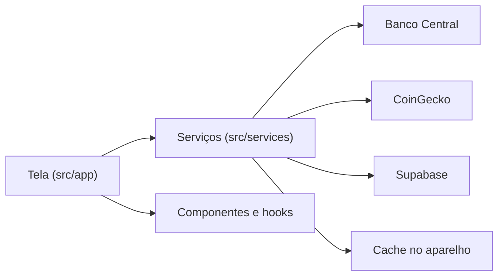

# Economia Hoje

Aplicativo Expo (React Native) que exibe indicadores econômicos e criptomoedas, com login, favoritos, histórico e versão web instalável (PWA).


## Sumário

- [Sobre o projeto](#sobre-o-projeto)
- [Funcionalidades](#funcionalidades)
- [Início rápido](#início-rápido)
- [Instalação](#instalação)
- [Uso](#uso)
- [Compatibilidade](#compatibilidade)
- [Arquitetura](#arquitetura)
- [Tratamento de erros](#tratamento-de-erros)
- [Testes](#testes)
- [Estrutura do projeto](#estrutura-do-projeto)
- [Publicação no Render](#publicação-no-render)
- [Limitações conhecidas](#limitações-conhecidas)
- [Solução de problemas](#solução-de-problemas)
- [Autores](#autores)
- [Licença](#licença)

## Sobre o projeto

Projeto acadêmico de Engenharia de Computação (FHO, Araras, SP), desenvolvido em grupo. O aplicativo roda no celular (Expo Go) e no navegador, com layout próprio para cada tela.

O projeto resolve os seguintes problemas:

1. **Consulta dispersa de indicadores.** Reúne dados do Banco Central e da CoinGecko em um único painel.
2. **Acompanhamento pessoal.** Permite favoritar indicadores, anotar e consultar a variação por período, com dados isolados por usuário.
3. **Uso sem internet.** Mostra os últimos dados salvos e avisa quando o aparelho está offline.

## Funcionalidades

- Painel com 9 indicadores de economia (IPCA do mês e de 12 meses, INPC, IGP-M, Selic, CDI, dólar, euro e desemprego) e 6 criptomoedas (Bitcoin, Ethereum, Solana, XRP, BNB e Dogecoin).
- Busca por nome ou palavra-chave e busca de qualquer criptomoeda; filtros Todos, Economia e Criptomoedas.
- Atualização ao puxar a tela ou ao sacudir o celular.
- Favoritos com nota (criar, listar, editar e apagar) e histórico de 7 dias, 30 dias e 12 meses.
- Login e cadastro com Supabase; cada pessoa acessa apenas os próprios dados (RLS).
- Biometria para abrir Favoritos e Perfil e para sair da conta.
- Aviso de modo offline e atualização automática ao voltar a internet.
- PWA instalável, com service worker.

## Início rápido

Requer Node 24 e uma conta no Supabase.

```bash
git clone https://github.com/App-mobile-economia/App-mobile-economia.git
cd App-mobile-economia
npm install
npx expo start --web
```

Antes da primeira execução, crie o arquivo `.env` (veja [Instalação](#instalação)).

## Instalação

| Requisito | Versão | Finalidade |
|---|---|---|
| Node.js | 24 (versão usada nos testes: 24.18.0) | Executar o Expo e o Jest |
| npm | 11 (versão usada: 11.16.0) | Instalar dependências |
| Expo Go | compatível com o SDK 57 | Abrir o app no celular |
| Conta Supabase | gratuita | Autenticação e tabela `favoritos` |

1. Instale as dependências:

   ```bash
   npm install
   ```

2. No [Supabase](https://supabase.com), crie um projeto e configure:
   - **SQL Editor:** execute o conteúdo de `supabase/schema.sql` (cria a tabela `favoritos` com RLS).
   - **Authentication > Sign In / Providers > Email:** para testar com mais facilidade, desligue "Confirm email".
   - **Project Settings > API:** copie a *Project URL* e a chave *anon*.

3. Copie `.env.example` para `.env` e preencha as duas variáveis. Nunca use a chave `service_role`.

   ```bash
   cp .env.example .env
   ```

## Uso

### Navegador

```bash
npx expo start --web
```

### Celular

```bash
npx expo start
```

Leia o QR code com o Expo Go.

### Versão estática (build web)

```bash
npm run build
```

O resultado é gravado na pasta `dist/`.

### Comandos disponíveis

| Comando | Função |
|---|---|
| `npm start` | Inicia o servidor de desenvolvimento |
| `npm run web` | Inicia no navegador |
| `npm run android` / `npm run ios` | Inicia no emulador |
| `npm run build` | Gera o site estático em `dist/` |
| `npm run lint` | Executa o ESLint |
| `npm test` | Executa os testes automatizados |

## Compatibilidade

| Recurso | Android (Expo Go) | iPhone (Expo Go) | Navegador / PWA |
|---|---|---|---|
| Painel, busca, favoritos e histórico | Sim | Sim | Sim |
| Sacudir para atualizar | Sim | Sim | Não |
| Biometria (digital) | Sim | Touch ID | Não (libera direto) |
| Face ID | Não se aplica | Somente em *development build* | Não |

Sem biometria cadastrada no aparelho, o app libera o acesso direto para não bloquear o usuário.

## Arquitetura



| Módulo | Responsabilidade |
|---|---|
| `src/app/_layout.tsx` | Decide a tela: logado vai para as abas, deslogado vai para o login |
| `src/app/login.tsx` | Entrar e criar conta, com validação de e-mail e senha |
| `src/app/(tabs)/index.tsx` | Painel: busca, filtros e cartões |
| `src/app/(tabs)/favoritos.tsx` | Lista, edita e apaga favoritos, com histórico |
| `src/app/(tabs)/perfil.tsx` | E-mail da conta e botão Sair (pede biometria) |
| `src/constants/indicadores.ts` | Lista dos indicadores; incluir um novo exige uma linha |
| `src/services/api.ts` | Valores atuais: Banco Central e CoinGecko |
| `src/services/historico.ts` | Histórico e variação por período |
| `src/services/busca.ts` | Busca de moedas por nome |
| `src/services/favoritos.ts` | CRUD no Supabase |
| `src/services/cache.ts` | Cache para o modo offline |
| `src/hooks/use-sacudir.ts` | Leitura do acelerômetro |
| `src/lib/` | Cliente Supabase e biometria |
| `public/` | `manifest.json`, `sw.js` e ícones do PWA |

Decisões de projeto:

- O código usa estilo simples e comentários em português, por finalidade didática.
- As buscas de fontes diferentes rodam em paralelo com `Promise.all`; se uma fonte falhar, as outras continuam.
- O service worker usa a estratégia "rede primeiro" e mantém uma cópia para uso offline.

## Tratamento de erros

| Origem | Comportamento |
|---|---|
| Login com campos inválidos | Mensagem "Informe o e-mail." ou "A senha precisa ter no mínimo 6 caracteres."; nada é enviado ao Supabase |
| Falha de rede ou API | O Painel mostra os últimos dados salvos e o aviso de offline |
| Cache corrompido | O cache é apagado e o Painel carrega normalmente |
| Falha em uma das fontes | Os indicadores da outra fonte continuam sendo exibidos |
| Supabase não configurado | A tela de login exibe o aviso para preencher o `.env` |

## Testes

```bash
npm test
```

Resultado medido em 10/11/2026: 18 arquivos e 228 testes aprovados. `npx tsc --noEmit` e `npx expo lint` não reportaram erros.

Os testes cobrem formatadores, lista de indicadores, serviços (`api`, `busca`, `historico`, `cache`, `favoritos`), biometria, hook de sacudir, componentes, telas (Painel, Favoritos, Login, Perfil), layout responsivo (limite de 900 px) e PWA (manifesto e service worker). Internet, Supabase, biometria e acelerômetro são simulados; os testes não acessam serviços reais.

## Estrutura do projeto

```
.
├── __tests__/        # testes automatizados (Jest)
├── jest/             # configuração e APIs simuladas dos testes
├── public/           # manifest.json, sw.js e index.html do PWA
├── src/
│   ├── app/          # telas e rotas (Expo Router)
│   ├── components/   # cartão, chip, etiqueta, biometria e tela de carregamento
│   ├── constants/    # app, cores e indicadores
│   ├── hooks/        # use-sacudir
│   ├── lib/          # supabase e biometria
│   ├── services/     # api, busca, cache, favoritos e histórico
│   └── utils/        # formatadores
├── supabase/         # schema.sql (tabela favoritos com RLS)
├── .env.example      # modelo das variáveis de ambiente
├── app.json          # configuração do Expo
├── render.yaml       # publicação no Render
└── package.json
```

## Publicação no Render

1. No Render, crie um **Blueprint** (ou Static Site) apontando para este repositório; ele lê o `render.yaml`.
2. Em **Environment**, preencha `EXPO_PUBLIC_SUPABASE_URL` e `EXPO_PUBLIC_SUPABASE_ANON_KEY`.
3. No Supabase, em **Authentication > URL Configuration**, informe o endereço do site do Render em *Site URL*.

Site publicado: https://app-mobile-economia.onrender.com

## Limitações conhecidas

- Os testes automatizados não cobrem biometria real, acelerômetro real, cadastro e RLS no Supabase real, instalação do PWA nem uso offline no navegador; esses itens exigem teste manual.
- O Face ID só funciona em *development build*, não no Expo Go.
- A biometria e o sacudir não existem na versão web.
- Os dados dependem de APIs públicas (Banco Central e CoinGecko) e podem sofrer limite de requisições.
- O comando `npm run build` e a publicação no Render não foram executados durante a elaboração deste README.

## Solução de problemas

| Sintoma | Causa provável | Ação |
|---|---|---|
| Login exibe "Supabase não configurado" | `.env` ausente ou incompleto | Copiar `.env.example` para `.env` e preencher as duas variáveis |
| Cadastro não permite entrar em seguida | "Confirm email" ligado no Supabase | Confirmar o e-mail recebido ou desligar a opção |
| Site no Render sem as variáveis | Variáveis não preenchidas antes do build | Preencher em Environment e refazer o deploy com "Clear build cache & deploy" |
| App no celular não carrega | Expo Go incompatível com o SDK 57 | Atualizar o Expo Go |
| PWA não abre offline | Primeiro acesso ainda não gravou o cache | Abrir o site uma vez com internet e recarregar |

## Autores

| Nome | Matrícula | E-mail |
|---|---|---|
| Guilherme Augusto Scaglia | 111598 | scaglia@alunos.fho.edu.br |
| João Pedro Denardo | 113036 | denardo749@alunos.fho.edu.br |
| Pedro Henrique Oliveira de Souza | 113364 | pedro1204@alunos.fho.edu.br |

Curso de Engenharia de Computação, Fundação Hermínio Ometto (FHO), Araras, SP.

## Licença

Licença MIT, conforme o arquivo `LICENSE`. Os direitos autorais de 2026 pertencem aos autores listados acima. O arquivo mantém também o aviso de direitos da Expo (650 Industries, Inc.), porque o projeto parte do modelo inicial do Expo, que usa a mesma licença.
